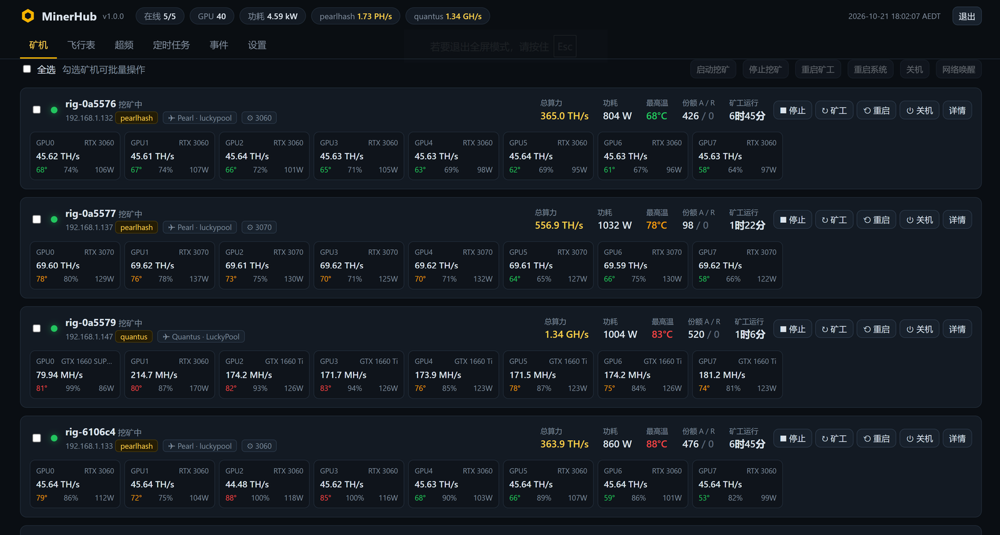
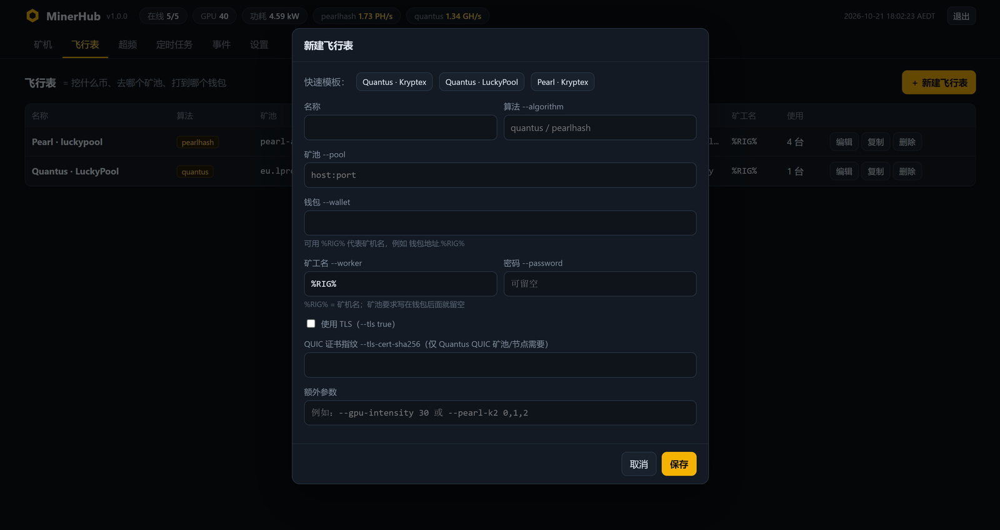
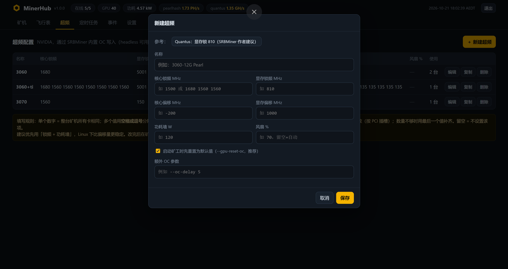
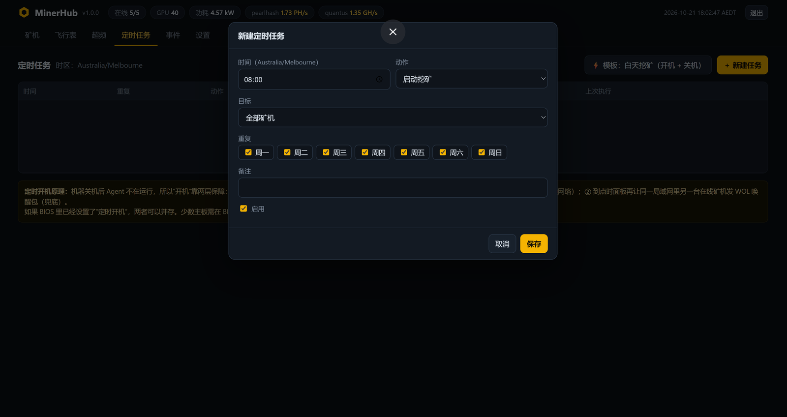
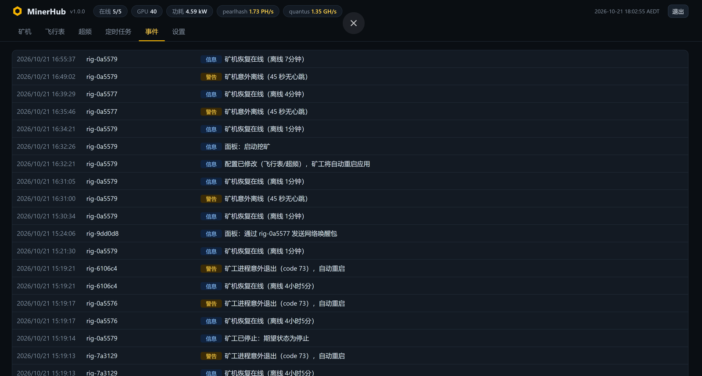
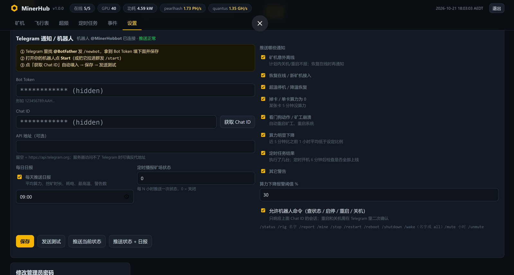
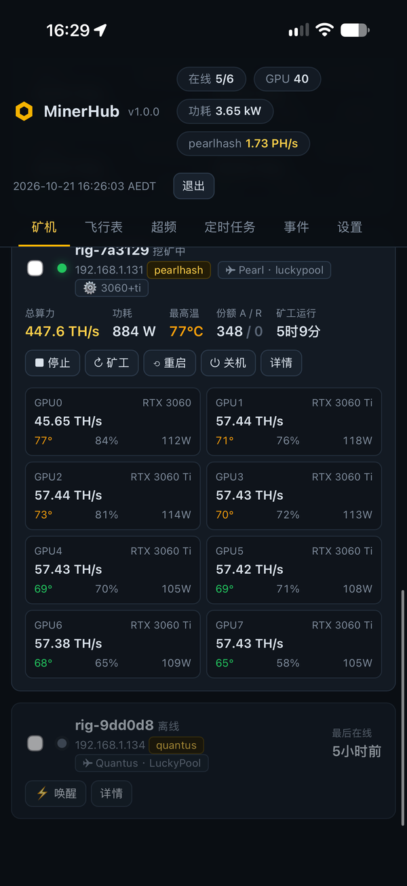

<div align="center">

# ⛏️ MinerHub

**自建矿场监控面板 · 免费的 HiveOS 替代方案**

监控算力和温度 · 超频 · 定时开关机 · 远程重启/关机 · 看门狗 · Telegram 告警与机器人

[中文](README.md) · [English](README_EN.md)

作者：**零度解说（LINGDU）** · 博客 <https://www.freedidi.com> · YouTube <https://www.youtube.com/@lingdujieshuo>

</div>

---



## 目录

- [为什么做这个项目](#为什么做这个项目)
- [功能一览](#功能一览)
- [截图](#截图)
- [工作原理](#工作原理)
- [第一步：部署面板](#第一步部署面板)
- [第二步：接入矿机](#第二步接入矿机)
  - [方式 A：MinerHub OS U 盘系统（推荐）](#方式-aminerhub-os-u-盘系统推荐)
  - [方式 B：在已有 Ubuntu 上安装 Agent](#方式-b在已有-ubuntu-上安装-agent)
- [第三步：开始挖矿](#第三步开始挖矿)
- [功能使用教程](#功能使用教程)
- [安全建议](#安全建议)
- [常见问题与排查](#常见问题与排查)
- [目录结构](#目录结构)
- [许可证与免责声明](#许可证与免责声明)

## 为什么做这个项目

HiveOS 开始额外收费，而小矿场真正需要的功能其实不多：看算力、看温度、超频、定时开关机、出问题能远程重启并且收到通知。

MinerHub 用**一个 Python 文件做面板，一个 Python 文件做矿机 Agent**，部署在你自己的服务器上。数据全部在你手里，没有订阅费，也不经过任何第三方。

- 面板和 Agent **只用 Python 3 标准库**，不需要 pip、Docker 或数据库服务（数据存在一个 SQLite 文件里）。
- 矿机端提供现成的 **MinerHub OS**：基于 Ubuntu Server 24.04，集成 NVIDIA 驱动、SRBMiner-MULTI 和 Agent，刻进 U 盘就能开机挖矿。
- 当前支持用 SRBMiner-MULTI 挖 **Quantus（算法 `quantus`）** 和 **Pearl（算法 `pearlhash`）**，飞行表里也可以填其它 SRBMiner 支持的算法。

## 功能一览

| 模块 | 功能 |
|---|---|
| **监控** | 整场 / 单机 / 单卡算力，温度、风扇、功耗、核心与显存频率、能效、份额 A/R、矿工运行时长；24 小时 / 7 天曲线；手机网页同样好用 |
| **飞行表** | 选好「挖什么币、去哪个矿池、打到哪个钱包」存为模板，一键分配给多台矿机；`%RIG%` 自动替换为矿机名；内置 Quantus · Kryptex / Quantus · LuckyPool / Pearl · Kryptex 模板 |
| **超频** | 核心锁频、显存锁频、核心/显存偏移、功耗墙、风扇；**支持 HiveOS 风格逐卡写法**（`1680 1560 1560 …`）；无桌面也能用（通过 NVML 写入） |
| **远程操作** | 启动/停止挖矿、重启矿工、重启系统、关机、网络唤醒（WOL）；可多选批量操作；在线查看矿工日志 |
| **定时任务** | 每天/每周指定时间开机、关机、启动/停止挖矿、重启；「白天挖矿」模板一键生成；定时开机用主板 RTC 闹钟 + WOL 双重保障 |
| **看门狗** | 矿工崩溃自动拉起；零算力 N 分钟重启矿工；反复无效则重启系统；超温停机、降温自动恢复；掉卡检测；系统卡死时用 sysrq 强制重启 |
| **Telegram** | 意外离线、恢复在线、超温、掉卡、看门狗动作、算力明显下降、定时任务结果、每日日报；**机器人命令**：`/status` `/rig` `/report` `/mine` `/stop` `/restart` `/reboot` `/shutdown` `/wake` `/mute` |
| **安全** | 面板地址加随机后缀（安全入口）防扫描爆破；登录失败限速；Farm Key 鉴权矿机 |
| **断网容错** | 面板挂了或断网，矿机照常按最后一次配置继续挖 |

## 截图

| 飞行表 | 超频（支持逐卡写法） |
|---|---|
|  |  |

| 定时任务 | 事件日志 |
|---|---|
|  |  |

| Telegram 通知 / 机器人 | 手机端 |
|---|---|
|  |  |

## 工作原理

```
┌──────────────────────┐        HTTP(S)         ┌────────────────────────────┐
│  MinerHub 面板        │ ◀──── 心跳 / 上报 ──── │  矿机 1：Agent + SRBMiner   │
│  server.py + SQLite   │ ───── 下发配置/命令 ──▶ │  矿机 2：Agent + SRBMiner   │
│  （局域网主机或 VPS）  │                        │  …… 任意多台                │
└──────────┬───────────┘                        └────────────────────────────┘
           │ 浏览器 / 手机访问                  ▲
           ▼                                    │ 主板 RTC 定时唤醒 / WOL 网络唤醒
       你（管理员） ──── Telegram 机器人 ─────────┘
```

- 矿机上的 **Agent** 每 10 秒向面板发心跳，上报算力、温度等数据，同时取回飞行表、超频和待执行的命令。
- 所有连接都由矿机**主动发起**，矿机不需要公网 IP，也不用开放任何端口。
- Agent 负责启动和守护矿工进程，并在本地执行看门狗、超温保护和定时关机。

## 第一步：部署面板

面板可以装在任意一台 Ubuntu / Debian 机器上：局域网小主机、其中一台矿机，或者一台 VPS 都行。它只需要 Python 3，资源占用很小。

```bash
# 1. 下载项目
git clone https://github.com/lingdujieshuo/MinerHub.git
cd MinerHub/server

# 2. 一键安装（默认端口 8800；要换端口就写 sudo bash install-server.sh 9000）
sudo bash install-server.sh
```

安装完成后，终端会打印出：

- **管理员密码**：登录后请到【设置】里修改。
- **带安全后缀的面板地址**，例如 `http://192.168.1.10:8800/a7k2m9x4q1/`。请收藏这个地址，直接访问不带后缀的地址会返回 404，这是为了防止被扫描和爆破。
- **矿机安装命令**：在方式 B 中使用。

安装后的文件位置：

| 路径 | 说明 |
|---|---|
| `/opt/minerhub-server/server.py`、`static/` | 面板程序 |
| `/opt/minerhub-server/data/minerhub.db` | **全部数据**（SQLite），备份这一个文件即可 |
| systemd 服务 `minerhub-server` | 开机自启，`journalctl -u minerhub-server -f` 查看日志 |

常用维护命令：

```bash
# 忘记密码
sudo MINERHUB_DATA=/opt/minerhub-server/data python3 /opt/minerhub-server/server.py passwd 新密码
# 修改安全入口后缀（写 off 关闭后缀）
sudo MINERHUB_DATA=/opt/minerhub-server/data python3 /opt/minerhub-server/server.py entrance 新后缀
# 升级面板：拉取最新代码后重新执行安装脚本（数据和密码会保留）
cd MinerHub && git pull && sudo bash server/install-server.sh
```

### 放在公网 VPS 上（可选）

1. 用 Nginx、1Panel、宝塔等建一个反向代理站点，指向 `127.0.0.1:8800`，并开启 HTTPS。
2. 到面板【设置 → 面板对外地址】填 `https://你的域名`，之后生成的矿机安装命令会自动使用这个地址。
3. 防火墙**不要**直接对外开放 8800 端口，只开放 443。

## 第二步：接入矿机

先登录面板，在【设置】页复制 **Farm Key**。矿机凭这个密钥接入你的面板。

### 方式 A：MinerHub OS U 盘系统（推荐）

MinerHub OS 是一个精简的 Ubuntu Server 24.04，**刻进 U 盘就能开机挖矿**：

- 集成 NVIDIA 驱动（预编译内核模块，开机即用）、SRBMiner-MULTI 和 MinerHub Agent。
- 支持 Legacy BIOS 和 UEFI，8 GB 及以上 U 盘都能用，首次开机会自动扩容到整个 U 盘。
- 专门为 U 盘做了优化：日志和临时文件放在内存里；没有 swap；关闭自动更新；锁定内核和驱动版本；意外断电后开机自动修复文件系统。

**1）构建镜像**

镜像约 1.5 GB，不放在仓库里，需要自己构建一次。准备一台 Ubuntu 22.04 / 24.04 x86_64 机器（虚拟机、VPS 或任意一台 Linux 主机都行），留出约 15 GB 空闲空间：

```bash
git clone https://github.com/lingdujieshuo/MinerHub.git
cd MinerHub/os
sudo SERVER=http://你的面板地址:8800 FARM_KEY=你的FarmKey bash build-image.sh
# 产物：os/out/minerhub-os-日期.img.xz
```

> `SERVER` 和 `FARM_KEY` 也可以不填，刻好 U 盘后再改配置文件。
> 国内网络建议加上 `MIRROR=http://mirrors.aliyun.com/ubuntu`。更多参数见 [os/README.md](os/README.md)。

**2）刻录 U 盘**

用 [balenaEtcher](https://etcher.balena.io/)（可以直接选 `.img.xz`）或 Rufus（选 DD 镜像模式）把镜像刻到 U 盘。

**3）修改配置**

刻完后，电脑上会多出一个名为 **MINERHUB** 的盘。用记事本打开里面的 `minerhub.txt`：

```ini
# 面板地址（矿机能访问到的地址，不要带安全入口后缀）
SERVER=http://192.168.1.10:8800
# 面板【设置】页里的 Farm Key
FARM_KEY=你的FarmKey
# 矿机名：留空 = rig-网卡MAC后6位
RIG_NAME=
# SSH / 控制台登录密码，请改掉默认值
PASSWORD=minerhub
# 留空 = DHCP 自动获取 IP（推荐）
STATIC_IP=
```

> 注意：注释必须单独写一行，不要写在值的后面。

**4）插到矿机上开机**

在 BIOS 里选择从 U 盘启动。大约 1 分钟后，矿机会出现在面板的【矿机】列表里。

> 💡 同一份配置可以刻任意多根 U 盘，矿机名按网卡 MAC 自动生成，不会重名。
> ⚠️ 矿机**换了主板**后网卡 MAC 会变，矿机会以新名字上线。建议给每台矿机填好 `RIG_NAME=`，换主板后名字就不会变。

**BIOS 建议设置：**

- 关闭 Secure Boot；启动顺序把 U 盘排第一。
- 多卡主板务必打开 **Above 4G Decoding**；如果识别不全或开机卡住，把 PCIe 速率设为 **Gen1 / Gen2**。
- **Restore on AC Power Loss = Power On**：停电恢复后自动开机。
- 要用定时开机：打开 **Wake on RTC / Resume by RTC Alarm**（设为 By OS）和 **Wake on LAN**。

### 方式 B：在已有 Ubuntu 上安装 Agent

前提：Ubuntu Server 22.04 / 24.04，NVIDIA 驱动已经装好（`nvidia-smi` 能正常输出）。没装驱动的话先执行：`sudo ubuntu-drivers install && sudo reboot`。

到面板【设置】页复制安装命令，在每台矿机上执行。末尾的矿机名可以省略：

```bash
curl -fsSL http://面板地址:8800/dl/install-agent.sh | sudo bash -s -- http://面板地址:8800 <FARM_KEY> rig-01
```

脚本会依次：安装依赖 → 下载最新版 SRBMiner → 安装 Agent → 注册开机自启 → 禁止休眠并开启 sysrq。几秒后矿机就会出现在面板里。

升级 SRBMiner：在同一条命令前加 `SRB_UPDATE=1`。

## 第三步：开始挖矿

1. **建飞行表**：【飞行表 → 新建飞行表】，点一个快速模板，填上**钱包地址**后保存。
2. **建超频**（可选）：【超频 → 新建超频】，按显卡型号填写，见下面的超频说明。
3. **分配**：在矿机卡片上点【详情 → 配置】，选好飞行表和超频方案。面板会预览最终的矿工启动命令。
4. 点【启动挖矿】。大约 10 秒后，就能看到每张卡的算力。

## 功能使用教程

### 飞行表（挖什么、去哪挖）

| 字段 | 说明 |
|---|---|
| 算法 | `quantus` 或 `pearlhash`（也可以填 SRBMiner 支持的其它算法） |
| 矿池 | `host:port` |
| 钱包 | 你的钱包地址；可写 `钱包地址.%RIG%`，`%RIG%` 会替换为矿机名 |
| 矿工名 | 默认 `%RIG%`；如果矿池要求把矿工名写在钱包后面，这里就留空 |
| TLS | 矿池要求 SSL 端口时勾选 |
| 额外参数 | 原样追加到矿工命令行，例如 `--gpu-intensity 30` |

### 超频

- **一个数字**：整台矿机所有卡都用这个值。
- **多个数字**（空格或逗号分隔）：按 PCI 插槽顺序逐卡设置，例如 `1680 1560 1560 1560`（GPU0 是 3060，其余是 3060 Ti）。数量不够时，用最后一个值补齐。
- 留空 = 不设置该项。
- Linux 下推荐用「**锁频 + 功耗墙**」，比偏移量更稳定。勾选「启动矿工时先重置为默认值」可以避免上一次的设置残留。
- 修改后不用手动重启，矿工会自动重启并应用新设置。

参考值（RTX 30 系挖 Pearl，仅供参考，请以自己矿机稳定为准）：

| 显卡 | 核心锁频 | 显存锁频 | 功耗墙 |
|---|---|---|---|
| RTX 3060 | 1680 | 5001 | 不设置 |
| RTX 3060 Ti | 1560 | 5001 | 不设置 |
| RTX 3070 | 1560 | 5001 | 不设置 |

### 定时任务

- 点「**模板：白天挖矿（开机 + 关机）**」，一键生成每天定时开机和关机的任务。适合按峰谷电价挖矿或白天用太阳能发电挖矿。
- 支持的动作：开机、关机、启动挖矿、停止挖矿、重启矿工、重启系统；可以选择全部矿机或单台矿机，以及每周哪几天执行。
- **定时开机原理**：机器关机后 Agent 不在运行，所以靠两层保障。① 关机前，Agent 把下次开机时间写入主板的 RTC 闹钟，断网也能生效。② 到点时，面板再让同一局域网里另一台在线矿机发送 WOL 唤醒包兜底。需要在 BIOS 里打开 RTC 唤醒和 WOL。
- 时区在【设置】里修改，定时任务按这个时区执行。

### 看门狗与保护（【设置】页）

| 设置 | 作用 |
|---|---|
| 超温停机 °C / 恢复温度 °C | 任一张卡超过停机温度就暂停挖矿，降到恢复温度后自动继续 |
| 零算力 N 分钟重启矿工 | 矿工卡死或算力为 0 时自动重启矿工 |
| 1 小时内重启矿工 N 次后重启系统 | 重启矿工无效时升级为重启系统（每天最多 3 次） |
| 掉卡检测 | 某张卡 5 分钟没有算力就告警（Telegram 可推送） |

### Telegram 通知与机器人

1. 在 Telegram 里找 **@BotFather**，发送 `/newbot`，拿到 Bot Token。
2. 打开你的机器人点 **Start**（也可以把它拉进群里，在群里发 `/start`）。
3. 面板【设置 → Telegram】填入 Bot Token，点「获取 Chat ID」，然后保存，再点「发送测试」。
4. 勾选需要推送的通知类型；如果想用命令控制矿机，打开「允许机器人命令」。

| 命令 | 作用 |
|---|---|
| `/status` | 矿场总览 |
| `/rig 矿机名` | 单台矿机详情 |
| `/report` | 立即发送日报 |
| `/mine` `/stop` `/restart` | 启动挖矿 / 停止挖矿 / 重启矿工 |
| `/reboot` `/shutdown` | 重启系统 / 关机（需要二次确认） |
| `/wake 矿机名 或 all` | 网络唤醒 |
| `/mute 小时` `/unmute` | 告警静音 / 取消静音 |

机器人只响应你填写的那个 Chat ID。服务器访问不了 Telegram 时，可以在「API 地址」里填反代地址。

### MinerHub OS 常用命令（SSH 登录用户名 `miner`）

| 命令 | 作用 |
|---|---|
| `mh status` | 矿机名、IP、面板地址、Agent / 矿工状态、各卡温度和功耗 |
| `mh log` | 实时查看矿工日志 |
| `mh agent` | 查看 Agent 日志 |
| `mh config` | 编辑 U 盘上的配置并立即应用 |
| `mh update` | 从面板下载最新版 Agent 并重启 |
| `mh update-srb [URL]` | 升级 SRBMiner |

## 安全建议

- **Farm Key 等同于矿机的 root 权限**（可以向矿机下发命令），不要外泄。如果泄露了，到【设置】里更换，再重新给矿机配置。
- 面板请保留**安全入口后缀**，并修改默认管理员密码。
- 放在公网时请使用 HTTPS 反向代理，不要直接暴露 8800 端口。
- 修改 MinerHub OS 的默认登录密码（`minerhub.txt` 里的 `PASSWORD=`）。
- 不要在公开场合发 Telegram Bot Token。

## 常见问题与排查

**矿机不上线 / 显示离线**
1. 先看【矿机】列表里有没有一台**新名字**的矿机。换主板或网卡后，矿机名会改变（见上文）。
2. 给矿机接上显示器：开机后屏幕会显示矿机名、IP 和面板地址。如果停在 BIOS，就检查启动顺序和多卡相关的 BIOS 设置。
3. SSH 登录后运行：`mh status`、`mh agent`，或 `journalctl -u minerhub-agent -n 50`。

**显卡识别不全 / 掉卡**
运行 `nvidia-smi` 看看识别到几张卡。识别不全通常是转接卡、延长线或供电的问题。可以先少插几张卡开机，再逐张加上去，找出有问题的那一张。

**单卡算力显示为 “—”**
在【详情 → 矿工日志】里展开「SRBMiner API 原始 JSON」，确认矿工 API 是否正常输出。

**日志位置**

```bash
journalctl -u minerhub-agent -f          # 矿机 Agent 日志
tail -f /var/log/minerhub/miner.log      # 矿工日志
journalctl -u minerhub-server -f         # 面板日志
```

## 目录结构

```
MinerHub/
├── server/                   面板（上传到面板服务器）
│   ├── server.py             后端：API、定时任务、看门狗策略、Telegram
│   ├── install-server.sh     一键安装（/opt/minerhub-server + systemd）
│   └── static/
│       ├── index.html        面板网页（单文件，支持手机）
│       └── dl/               矿机从面板自动下载的文件
│           ├── agent.py          矿机端 Agent
│           └── install-agent.sh  矿机一键安装脚本
├── os/                       MinerHub OS 镜像构建
│   ├── build-image.sh        构建脚本（输出 os/out/*.img.xz）
│   ├── config-partition/     U 盘 MINERHUB 配置分区模板（minerhub.txt）
│   └── rootfs/               打进系统的文件（开机配置、systemd 服务、mh 工具）
└── docs/images/              截图
```

## 许可证与免责声明

本项目基于 [MIT License](LICENSE) 开源。

- MinerHub 本身**不包含任何挖矿程序**。SRBMiner-MULTI 由其作者另行发布，在安装时从官方 GitHub 下载，并按其规则收取开发者费用。
- 挖矿有电费、硬件损耗和币价波动等风险，超频可能导致系统不稳定。请根据当地法律法规和自身情况决定是否挖矿，风险自负。

---

<div align="center">

如果这个项目对你有帮助，欢迎点个 ⭐ Star，也欢迎关注作者：

📝 博客：**[零度博客 freedidi.com](https://www.freedidi.com)** · 📺 YouTube：**[零度解说 @lingdujieshuo](https://www.youtube.com/@lingdujieshuo)**

</div>
